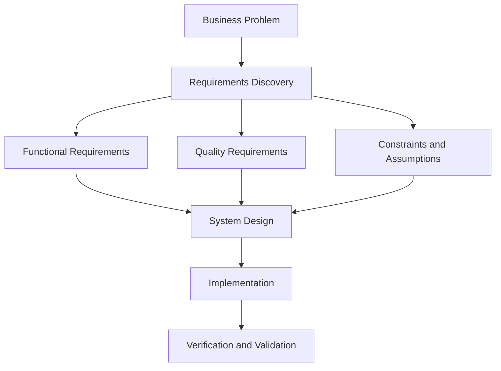

# Lesson 01 — Requirements Engineering: Understanding a Problem Before Designing a System

> **Subject:** Low-Level Design & High-Level Design
> **Level:** Beginner to Intermediate
> **Topic:** Requirements discovery, analysis, specification and validation
> **Prerequisites:** None — foundational lesson
> **Tags:** `system-design` `requirements-engineering` `LLD` `HLD` `NFR` `quality-attributes`

## 1. Learning objectives

By the end of this lesson, you should be able to:

- Explain what requirements engineering is.
- Distinguish functional requirements, quality requirements, constraints and assumptions.
- Identify system scope and out-of-scope features.
- Elicit requirements from a vague problem statement.
- Convert vague requirements into measurable and testable statements.
- Understand SLI, SLO and SLA.
- Explain how requirements influence LLD and HLD decisions.
- Structure requirements discussions in system design interviews.

## 2. What is requirements engineering?

Requirements engineering is the process of discovering, analysing, documenting, validating and managing the needs and constraints of a software system.

It converts a vague business problem into concrete expectations that can guide design, implementation and verification.

Example problem:

"Design a URL shortener."

Before designing it, clarify:

- Who can create short URLs?
- Are users authenticated?
- Are custom aliases supported?
- Can URLs expire?
- Is analytics required?
- What is the expected request volume?
- What is the acceptable latency?
- What should happen when a dependency fails?

The answers influence the system's architecture.

### Requirements-to-implementation flow



A good architecture is one that satisfies the requirements within the available constraints.

## 3. Types of requirements

### 3.1 Functional requirements

Functional requirements describe what the system must do.

They define observable behaviours, operations, features and interactions.

URL shortener examples:

| ID | Requirement |
|---|---|
| FR-01 | A user can submit a long URL and receive a short URL. |
| FR-02 | A visitor can use a short URL to reach the original URL. |
| FR-03 | The system returns an appropriate error for an unknown short code. |
| FR-04 | The system handles expired URLs according to the expiry policy. |
| FR-05 | The system prevents duplicate custom aliases. |

A functional requirement should be specific enough to implement and test.

### 3.2 Non-functional requirements / quality attributes

Quality requirements describe how well the system must perform its responsibilities and the conditions under which it must operate.

| Attribute | Meaning | Example |
|---|---|---|
| Performance | How quickly operations complete | 95% of redirects complete within 100 ms |
| Scalability | Ability to handle workload growth | Support an agreed peak of 5,000 redirects/second |
| Availability | Whether the service can be used | Target 99.9% successful redirect availability |
| Reliability | Consistent correct operation | A node failure must not corrupt URL mappings |
| Durability | Protection against data loss | Acknowledged mappings survive defined failure scenarios |
| Security | Protection against misuse | Authenticated creation and rate limiting |
| Maintainability | Ease of modification | New link policies can be added without changing redirect semantics |
| Observability | Ability to understand system behaviour | Measure latency, errors and traffic |
| Cost efficiency | Resource use relative to value | Meet workload targets within the infrastructure budget |

The values above are illustrative, not universal recommendations. Actual targets must be agreed with stakeholders.

Non-functional does not mean optional. A system can implement all its features and still fail because it is too slow, insecure, unreliable or expensive.

### 3.3 Constraints

Constraints restrict the available design choices.

Examples:

- The backend must use Java and Spring Boot.
- The application must run on an existing Kubernetes cluster.
- Data must remain within a specified geographic region.
- An existing payment provider must be used.
- The project must fit a fixed budget.

Distinction:

- "Must use PostgreSQL" is a technology constraint.
- "Must support 10,000 writes per second" is a performance requirement.
- "Must store customer data in a specified region" is a data residency constraint.

### 3.4 Assumptions

Assumptions are provisional beliefs used when the problem statement lacks information.

Examples:

- URL creation requires an authenticated account.
- Short codes are case-sensitive.
- Analytics are not required in the first version.
- Users access the system over HTTPS.

High-impact assumptions must be validated. A wrong assumption can invalidate an otherwise sound design.

### 3.5 Scope and out-of-scope

Scope determines what the current design must support.

For a basic URL shortener:

**In scope**
- Create a short URL.
- Redirect to the original URL.
- Handle unknown and expired links.
- Enforce custom alias uniqueness if aliases are included.

**Out of scope for the initial version**
- Click analytics.
- QR-code generation.
- Team administration.
- Advertising and monetisation.

Explicit scope prevents unnecessary complexity.

## 4. Requirement discovery process

Use this sequence in design interviews:

1. Identify users and actors.
2. Understand the main workflows.
3. Define functional requirements.
4. Define quality requirements.
5. Identify constraints and assumptions.
6. Establish workload and scale.
7. Prioritise and validate.

### Questions for a URL shortener

#### Users and features
- Are users authenticated?
- Can anonymous users create links?
- Are custom aliases supported?
- Can users delete or expire links?
- Are click analytics required?

#### Workload
- How many URLs are created per day?
- What is the expected redirect traffic?
- Is redirect traffic much higher than creation traffic?
- Are sudden traffic spikes expected?

#### Performance
- What is the acceptable redirect latency?
- Does creation have a different latency target?
- Are there geographic latency requirements?

#### Reliability and consistency
- What should happen when a server fails?
- Must a newly created URL be immediately usable?
- Can analytics be delayed?
- What data loss is acceptable?

#### Security
- Can malicious URLs be submitted?
- Do we need rate limits?
- How should abuse be detected?
- What user data must be retained or deleted?

Ask questions that could change the design. Do not turn clarification into an exhaustive questionnaire.

## 5. Convert vague requirements into measurable requirements

| Vague requirement | More precise requirement |
|---|---|
| The application should be fast. | 95% of redirect requests complete within 100 ms under the specified workload. |
| The system should scale. | Support 5,000 redirect requests/second at the agreed latency target. |
| The system should be highly available. | At least 99.9% of eligible redirect requests succeed over a rolling 30-day period. |
| The application should be secure. | Creation requires authentication and per-user/per-IP rate limits. |
| The system should be reliable. | Acknowledged mappings are not lost during the specified single-node failure scenario. |

A measurable requirement should define:

- Measurement location.
- Request types included.
- Workload and operating conditions.
- Measurement window.
- Success and failure criteria.

### 5.1 Quality attribute scenarios

The Software Engineering Institute describes quality attribute scenarios using six elements:

1. Source: Who or what generates the event?
2. Stimulus: What event occurs?
3. Environment: Under what conditions?
4. Artifact: Which component is affected?
5. Response: What should the system do?
6. Response measure: How is success measured?

Example: performance.

| Element | Description |
|---|---|
| Source | Visitor |
| Stimulus | Requests a short URL |
| Environment | Normal peak load |
| Artifact | Redirect service |
| Response | Resolve the code and return a redirect response |
| Response measure | 95% of eligible requests complete within 100 ms |

Example: failure.

| Element | Description |
|---|---|
| Source | Infrastructure |
| Stimulus | One application instance crashes |
| Environment | Normal production traffic |
| Artifact | Redirect service |
| Response | Remaining instances continue serving requests |
| Response measure | Requests remain within agreed availability and latency targets |

This converts vague quality labels into requirements that can guide architecture and testing.

## 6. SLI, SLO and SLA

| Term | Meaning | Example |
|---|---|---|
| SLI | Service Level Indicator: what is measured | Successful redirect request ratio |
| SLO | Service Level Objective: target for a measured service level | 99.9% successful redirects over 30 days |
| SLA | Service Level Agreement: agreement that may specify consequences | Contractual availability commitment with defined remedies |

- SLI tells us how the service is performing.
- SLO tells us the expected target.
- SLA defines the agreement and potential consequences if it is not met.

### 6.1 Why latency percentiles matter

Suppose request latencies are:

```text
20 ms, 25 ms, 30 ms, 40 ms, 900 ms
```

Average = 203 ms.

Median = 30 ms.

The average hides the slow request.

Common metrics:

- p50: median latency.
- p95: 95% of requests complete at or below this latency.
- p99: 99% of requests complete at or below this latency.
- Throughput: operations per unit of time.
- Error rate: proportion of requests failing under a defined error policy.

Choose metrics that represent actual user experience. Avoid blindly optimising every metric.

## 7. How requirements influence architecture

| Requirement | Possible design consequence |
|---|---|
| High redirect traffic | Read optimisation, caching and horizontal scaling |
| Custom aliases must be unique | Database uniqueness enforcement and concurrency-safe creation |
| New links must be immediately usable | Read-after-write consistency considerations |
| Analytics may be delayed | Asynchronous event processing may be acceptable |
| Links can expire | Expiry checks, retention policy and background cleanup |
| Multiple geographic regions | Regional deployment and replication |
| Strict data residency | Region-specific storage and processing |
| Sensitive account data | Authentication, authorisation, encryption and audit controls |

A requirement does not automatically dictate a technology.

High read traffic does not automatically mean Redis. Evaluate read patterns, latency, consistency, working-set size and cost first.

### 7.1 LLD versus HLD

| Area | LLD emphasis | HLD emphasis |
|---|---|---|
| Behaviour | Methods and operations | System-level workflows |
| State | Object state and transitions | Persistent and distributed state |
| Correctness | Invariants and business rules | End-to-end correctness |
| Concurrency | Locks, races and thread safety | Concurrent requests and coordination |
| Performance | Algorithmic efficiency | Latency, throughput and capacity |
| Failure | Exceptions and component recovery | Node, service, network and region failures |
| Security | Validation and access checks | Trust boundaries and data protection |

LLD and HLD use the same requirements but translate them into different levels of design.

## 8. Writing useful requirements

Good requirements should be:

- Necessary.
- Unambiguous.
- Verifiable.
- Feasible.
- Traceable.
- Consistent.
- Prioritised.

### 8.1 MoSCoW prioritisation

- Must have: essential.
- Should have: important but not essential for the first release.
- Could have: useful if resources permit.
- Won't have now: explicitly deferred.

Example:

| Feature | Priority |
|---|---|
| Create short URL | Must |
| Redirect short URL | Must |
| Unknown-link handling | Must |
| Custom aliases | Should |
| Click analytics | Could |
| QR-code generation | Won't have now |

## 9. Common mistakes

1. Choosing technologies before understanding requirements.
2. Ignoring invalid input, expiry and duplicate aliases.
3. Using vague NFRs such as "highly scalable".
4. Overengineering an MVP.
5. Treating assumptions as confirmed requirements.
6. Ignoring cost.
7. Failing to prioritise.
8. Not validating requirements with stakeholders.

## 10. Interview questions and answers

### Basic

**Q1. Difference between functional and non-functional requirements?**

Functional requirements define capabilities and behaviour. Quality requirements define properties such as latency, availability, security and maintainability.

**Follow-up: Can a system satisfy functional requirements and still fail?**

Yes. It can produce correct results but be slow, insecure, unreliable or too expensive.

**Q2. Difference between a constraint and a quality requirement?**

A constraint restricts design choices. A quality requirement defines an expected property of the system.

Example: "Must use Java" is a technology constraint; "95% of requests must finish within 200 ms" is a performance requirement.

**Q3. What is an assumption?**

A provisional belief used when information is missing. It should be documented and validated.

### Intermediate

**Q4. Why define quality requirements before architecture?**

Architecture involves trade-offs. Workload, latency, reliability, security and consistency targets are necessary to evaluate design decisions.

**Q5. Why might average latency be insufficient?**

It hides tail latency. p95 and p99 reveal slow requests that can materially affect users.

**Q6. Does high availability mean no failures?**

No. It means the service meets its availability objective despite failures. Define failure scenarios, acceptable degradation and recovery expectations.

### Advanced

**Q7. What if the interviewer asks for 100% availability?**

Clarify the business meaning and measurement. Explain that absolute availability is not a realistic engineering target. Discuss failure budgets, recovery expectations, redundancy, dependency risks and cost.

**Q8. What if performance and consistency requirements conflict?**

Identify which operations require strong consistency and which can tolerate stale or delayed data. For example, a new URL may need immediate read-after-write visibility while analytics may be asynchronous.

**Q9. How do you handle incomplete requirements?**

Identify uncertainty, ask the highest-impact question, state a reasonable assumption if necessary, and document it so the design can be revised.

## 11. Practical exercise

Write a requirements specification for a notification system.

Potential features:
- Users can receive notifications.
- Support email, SMS and push.
- Users manage notification preferences.
- Track delivery status.

Questions:

1. Should notifications be delivered immediately?
2. What happens if an email provider is unavailable?
3. Can a notification be delivered more than once?
4. Can users unsubscribe?
5. Are notifications ordered?
6. How long are delivery records retained?
7. What is the acceptable delivery delay?
8. How many notifications might arrive in a burst?

Do not design the architecture yet. First write:

- Actors.
- Functional requirements.
- Quality requirements.
- Constraints.
- Assumptions.
- In-scope and out-of-scope features.
- Workload estimates or questions.
- Failure expectations.

## 12. Key takeaways

1. Understand requirements before selecting architecture.
2. Functional requirements describe what the system does.
3. Quality requirements describe how well it must work.
4. Constraints restrict possible solutions.
5. Assumptions must be documented and validated.
6. Requirements should be measurable and testable.
7. Quality attributes drive architectural trade-offs.
8. LLD and HLD use the same requirements at different levels.

## 13. Knowledge check

1. Which requirement specifies what the system must do?
2. Is "must use Kubernetes" a constraint or a performance requirement?
3. Which metrics reveal slow-tail requests?
4. What is the difference between SLI, SLO and SLA?
5. What should you do with a high-impact unknown during a design interview?

## 14. References

- [SEI — Reasoning About Software Quality Attributes](https://www.sei.cmu.edu/library/reasoning-about-software-quality-attributes/)
- [NASA Systems Engineering Handbook — Requirements Checklist](https://www.nasa.gov/reference/system-engineering-handbook-appendix/)
- [Google SRE Book — Service Level Objectives](https://sre.google/sre-book/service-level-objectives/)
- [AWS Well-Architected Framework](https://docs.aws.amazon.com/wellarchitected/latest/framework/)
- [SEI — Defining Non-Functional System Qualities](https://resources.sei.cmu.edu/asset_files/Book/2016_014_001_634914.pdf)

## 15. Related lessons

No previous lessons yet. Add links to future lessons on quality attributes, capacity estimation, APIs, architecture trade-offs and system design once they are covered.
